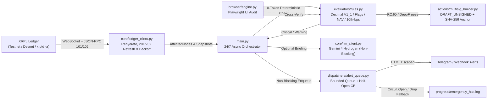

# 🛡️ Project Hermes: Institutional Off-Chain Risk Sentinel
**Hybrid Audit Architecture for XLS-65 (Single Asset Vaults) & XLS-66 (Native Lending) on the XRP Ledger**

* **Status:** Active Research & Development / XRPL Grants Candidate
* **Target Standards:** XLS-65, XLS-66 (`LendingProtocolV1_1`)
* **Funding Request:** $45,000 USD (3 Milestones of $15,000 USD)

---

## 🛡️ Executive Summary

Project Hermes is an open-source, hybrid off-chain risk sentinel designed to protect institutional liquidity providers and depositors interacting with lending markets on the XRP Ledger (XRPL). While ledger state changes execute deterministically on-chain, off-chain operational risks—such as First-Loss Capital Ratio (FLCR) depletion, credit concentration, and dApp front-end desynchronization—require dedicated monitoring architecture.

Hermes bridges this gap via a two-layer verification model:
1. **Passive On-Chain Sentinel (24/7, $0.00 / 0 Tokens):** High-throughput WebSocket/JSON-RPC listener evaluating ledger state and calculating deterministic `Decimal` risk metrics (`evaluators/rules.py`). Operates reliably both online (Testnet/Devnet/Mainnet) and offline (`xrpld -a --start` standalone sandbox) with zero LLM runtime dependency.
2. **Active UI & Diagnostics Layer (Optional):** Headless browser automation (`browser/engine.py`) paired with optional multimodal AI analysis via **`gemini-4-hydrogen`** (migrated from `gemini-3.8-flash`, configurable via `GEMINI_MODEL` in `core/llm_client.py`) to detect front-end discrepancies and synthesize critical incident briefings.

---

## 🎯 Architectural Scope & Actor Delimitation

Project Hermes operates strictly as an off-chain audit and risk governance layer, maintaining zero execution or custody risk over protocol liquidity:

* **Loan Broker:** Hermes does not manage credit facilities or handle pool funds. It passively audits the Loan Broker by continuously evaluating First-Loss Capital Ratio (`FLCR >= 10%`) compliance under `LendingProtocolV1_1` cash-basis accounting (`EffectiveDebt = PrincipalDebt + RealizedInterest`).
* **Borrower:** Hermes does not issue loans or conduct off-chain credit scoring. It deterministically audits single-borrower exposure (`max_borrower_share <= 20%`) and portfolio concentration (`HHI <= 0.25`, `config/parameters.yaml`) to prevent systemic exposure.
* **Depositor:** Depositors do not interact directly with Hermes; they are the primary protected institutional entity. Hermes runs real-time telemetry across a 4-Tier Matrix (`VERDE`, `AMARILLO`, `NARANJA`, `ROJO` / `CRITICAL_DEEP_FREEZE`) and dispatches resilient non-blocking alerts.

---

## 🏗️ System Architecture Diagram



---

## 📂 Project Repository Structure

```text
xrpl-auditor-project/
├── main.py                         # Async 24/7 sentinel orchestrator (AffectedNodes + stream + queue)
├── run_sentinel.py                 # Single-shot live audit entrypoint
├── config/
│   ├── settings.py                 # Dynamic env/YAML/JSON settings loader
│   ├── networks.json               # Testnet, Devnet & local Standalone (ws://localhost:6006)
│   └── parameters.yaml             # Institutional FLCR, HHI & borrower concentration thresholds
├── core/
│   ├── ledger_client.py            # Correlated JSON-RPC (101/102), 64-hex refresh (201/202) & backoff
│   ├── llm_client.py               # Optional Gemini 4 Hydrogen connector (Zero-LLM fallback)
│   ├── auditor.py                  # LTV / DSCR credit position auditor
│   └── notifier.py                 # Async Telegram alert transport
├── evaluators/
│   ├── rules.py                    # Deterministic Decimal rules (V1_1, flags, NAV, 1/10th bps, 60s buffer)
│   └── ui_verifier.py              # Front-end vs. ledger consistency verifier
├── dispatchers/
│   └── alert_queue.py              # Bounded queue (Dropping Policy), Circuit Breaker (Half-Open) & HTML Telegram
├── browser/
│   └── engine.py                   # Headless Playwright engine for dApp UI inspection
├── actions/
│   └── multisig_builder.py         # Non-custodial DRAFT_UNSIGNED emergency payload builder
├── telemetry/
│   └── crypto_anchor.py            # SHA-256 / HMAC-SHA256 audit proof anchoring
├── specs/
│   ├── FINANCIAL_ARCHITECTURE.md   # Quantitative model, tranche waterfall & standalone sandbox
│   └── xls65_xls66_spec.md         # Protocol specifications for XLS-65 / XLS-66
├── tests/                          # Deterministic pytest suite (rules, dispatcher, AffectedNodes, stress)
├── Dockerfile                      # Containerized sentinel runtime
├── docker-compose.yml              # Agnostic deployment + xrpld -a --start standalone sandbox
├── .env.example                    # Public environment template (no secrets)
├── requirements.txt                # Reproducible Python dependencies
├── RESEARCH_PROPOSAL_HERMES.md     # Full XRPL Grants proposal
├── AGENTS.md                       # Operational guidelines for autonomous coding agents
└── README.md                       # Repository root documentation
```

---

## 📊 Key Mathematical Risk Evaluators

Hermes executes continuous deterministic evaluation (`decimal.Decimal`, `ROUND_DOWN`) block-by-block:
* **First-Loss Capital Ratio (FLCR — V1_1 Cash-Basis):** Monitors `FirstLossCapital / (PrincipalDebt + RealizedInterest)` ignoring uncollected accrued interest, with zero-debt division guards and automatic `1/10th bps` (`0..100000`) on-chain `CoverRateMinimum` normalization.
* **Vault Access, DeepFreeze & NAV Parity (XLS-65 / XLS-77d):** Sanitizes heterogeneous `Flags` (`int(flags, 0)`), audits `lsfVaultPrivate` (`0x00010000`), detects TrustLine Freeze (`0x00400000`/`0x00800000`) & DeepFreeze (`0x02000000`/`0x04000000`), enforces Closed-Ended 60s maturity buffers & `fixCleanup3_4_0` cover invariants, and verifies 6-decimal truncated `NAV per Share`.
* **Concentration Risk (Share & HHI):** Enforces `max_borrower_share <= 20%` and `HHI <= 0.25` to prevent single-borrower capital over-exposure.
* **Value at Risk ($\text{VaR}_{99\%}$):** Non-parametric tail-risk estimation documented in `specs/FINANCIAL_ARCHITECTURE.md`.

---

## 🗺️ Milestones & Budget Breakdown

| Milestone | Technical Scope | Deliverables | Budget |
| :--- | :--- | :--- | :--- |
| **Milestone 1** | Core RPC Listener & FLCR Evaluators | WebSocket stream, `core/ledger_client.py` & `evaluators/rules.py` | **$15,000 USD** |
| **Milestone 2** | Playwright UI Engine & AI Classifier | Headless scraping (`browser/engine.py`) & `gemini-4-hydrogen` diagnostics | **$15,000 USD** |
| **Milestone 3** | Docker Packaging, SDK & Documentation | `docker-compose.yml` (`xrpld -a --start` sandbox) & developer guides | **$15,000 USD** |

---

## 🛡️ Security, Key Management & Zero-Trust Architecture

* **Non-Custodial Design (Zero Seed Phrase Exposure):** Project Hermes never requests, stores, or processes private keys or seed phrases. It operates strictly via passive, read-only RPC/WebSocket queries.
* **Decoupled Client-Side Signing:** All emergency mitigations (`FREEZE_CREDIT`) are built exclusively as unsigned payloads (`DRAFT_UNSIGNED`) for external hardware/multi-sig signing.
* **Resilient Alert Delivery:** Outbound alerts pass through a bounded async queue (`QUEUE_MAX_SIZE = 1000`, Dropping Policy) and a Half-Open Circuit Breaker (`COOLDOWN_PERIOD = 30s`) with HTML-escaped Telegram delivery and atomic local fallback (`progress/emergency_halt.log`).

---

## ⚡ Empirical Performance & Hardware Telemetry

1. **Latency & Execution Breakdown**
   * Total Audit Cycle Execution: `~2.11 s` (`2,113 ms` total elapsed time).
   * Network I/O Latency (XRPL RPC Node): `~1.85 s`.
   * Deterministic Risk Engine (`Decimal` FLCR/HHI): `< 1 ms`.
   * Unsigned Payload Generation (`DRAFT_UNSIGNED`): `< 1 ms`.
   * Cryptographic SHA-256 Telemetry Anchor: `< 2 ms`.
2. **Memory & Hardware Footprint**
   * Background Listener (WebSocket Stream): `52.89 MB RAM`.
   * Core Persistent Engine (Risk Evaluators): `226.71 MB RAM`.
   * Energy Impact: `< 15W TDP` average load.
3. **Token Economics & Operational Cost**
   * **Core Financial Sentinel (24/7 Online & Offline):** **0 Tokens ($0.00 USD)** — fully deterministic with zero LLM API calls required.
   * **Optional AI Layer (`gemini-4-hydrogen`):** Invoked strictly on-demand for UI discrepancy snapshots or critical incident summaries ($0.00 USD within Google AI Studio Free Tier limits; ~$0.015–$0.03 USD per 10k–20k input-token UI audit in Paid Tier).

---

## 🚀 Quickstart (Local, Standalone Sandbox & QA Tests)

```bash
# 1. Install dependencies & configure environment
pip install -r requirements.txt
cp .env.example .env

# 2. Run the 24/7 asynchronous sentinel (Testnet by default via XRPL_WS_URL)
python main.py

# 3. Run offline/sovereign Docker Standalone sandbox (xrpld -a --start on ws://localhost:6006)
docker compose --profile standalone up -d

# 4. Run deterministic QA test suite
python -m pytest tests/test_rules.py tests/test_dispatcher.py tests/test_sentinel_integration.py tests/test_systemic_stress.py -v
```

---

## ⚖️ License

Released under the **MIT Open-Source License**. Designed for institutional sovereignty and transparency on the XRP Ledger.